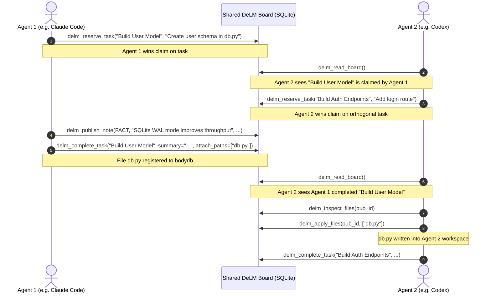

# DeLM Multi-Agent MCP Server Architecture & Technical Reference

This document details the architectural design, internal implementation mechanics, and end-to-end usage of the DeLM Model Context Protocol (MCP) server.

---

## 1. High-Level Architecture

The DeLM MCP server bridges the gap between AI coding assistants (Claude Code, OpenAI Codex, OpenCode, and Antigravity) and DeLM's decentralized multi-agent coordination engine.

Instead of relying on a centralized coordinator model that orchestrates subagents, DeLM enables **peer-to-peer asynchronous coordination**:
- Agents discover tasks and claim work without an orchestrator bottleneck.
- Agents publish verified discoveries (`FACT`) and disproven hypotheses/blockers (`FAIL`).
- Agents inspect and apply diffs from other agents' work workspaces.


---

## 2. Core Implementation Mechanics

The server is implemented in [`mcp_server/server.py`](../mcp_server/server.py) with zero third-party dependencies, running strictly on the Python 3.12+ standard library.

### A. Transport & Protocol Framing
The MCP specification communicates over standard input/output (`stdio`).
- **Framing**: Supports both HTTP-style header-framed messages (`Content-Length: <n>\r\n\r\n{...}`) and raw newline-delimited JSON.
- **Protocol Handshake**: Implements standard JSON-RPC 2.0 methods:
  - `initialize`: Negotiates protocol version (`2024-11-05`), server capabilities, and client identity.
  - `tools/list`: Exposes available coordination tools with complete JSON schema specifications.
  - `tools/call`: Dispatches function calls with validation and error formatting.
  - `ping`: Health-check keepalive.

### B. Shared Context & Dual-Database Storage
The server wraps [`SharedContext`](../board/shared_context.py), which uses a dual-database pattern:
1. `board.sqlite`:
   - Append-only event log (`events` table) storing sequence numbers, nanosecond timestamps, actor names, event kinds (`item`, `claim`, `done`, `note`, `status`, `read`, `wait`), and lightweight payloads.
   - Used for synchronization and atomic queue transitions.
2. `context-bodies.sqlite`:
   - Attached via SQLite's `ATTACH DATABASE ... AS bodydb`.
   - Stores file payloads, diff fingerprints, and publication metadata (`bodies`, `publications` tables).
   - Keeps large file contents out of the main transaction log so reads and status polls remain microsecond-fast.

### C. Concurrency & Collision Safety
- **Normalized Deduplication**: Task reservations normalize text (ignoring case and whitespace), preventing two agents from claiming duplicate variants of the same task.
- **Single-Claim Invariant**: An agent holding an unfinished item is blocked from claiming a second one until the active item is completed or released.
- **Author Provenance**: Applied files track authorship. Agents cannot accidentally overwrite local work with older peer revisions.

---

## 3. Tool Reference

The MCP server exposes 8 coordination tools to connected models:

| Tool | Action | Primary Arguments | Description |
| :--- | :--- | :--- | :--- |
| `delm_read_board` | Read / Poll | `wait_seconds`, `full` | Reads current queue state, peer notes, and statuses. With `wait_seconds > 0`, blocks until a wake event occurs. |
| `delm_reserve_task` | Atomic Scope Claim | `subject`, `detail` | Creates a new task item and claims it atomically. If an equivalent subject already exists, returns existing status. |
| `delm_claim_task` | Claim Open Task | `item_id` | Claims an already published open task from the queue. |
| `delm_complete_task` | Complete Work | `item_id`, `summary`, `attach_paths` | Marks item done, registers completion summary, and attaches workspace files into `context-bodies.sqlite`. |
| `delm_publish_note` | Share Knowledge | `note_type` (`FACT`/`FAIL`), `text`, `scope`, `basis`, `attach_paths` | Broadcasts discoveries or blockers with reproducible evidence. |
| `delm_update_status` | Status Broadcast | `text` | Informs peers of current focus (e.g. `"Investigating memory leak in auth.py"`). |
| `delm_inspect_files` | Diff Preview | `publication_id`, `paths` | Displays unified diffs against baseline files or full text for newly introduced files. |
| `delm_apply_files` | Merge Files | `publication_id`, `paths` | Writes files published by a peer into the agent's local workspace. |

---

## 4. Multi-Agent Workflow Example

Here is how two autonomous agents collaborate on a codebase using the MCP tools:



---

## 5. How It Is Used Across Clients

Each client launches an MCP server process over standard I/O pointing to the same shared SQLite file (`.delm/board.sqlite`).

### Claude Code
Run in terminal:
```bash
claude mcp add delm -- python3 /path/to/DeLM/mcp_server/cli.py \
  --actor claude-agent \
  --board /shared/project/.delm/board.sqlite \
  --workspace .
```

### OpenAI Codex
Add to `~/.codex/config.json`:
```json
{
  "mcpServers": {
    "delm": {
      "command": "python3",
      "args": [
        "/path/to/DeLM/mcp_server/cli.py",
        "--actor", "codex-agent",
        "--board", "/shared/project/.delm/board.sqlite",
        "--workspace", "."
      ],
      "env": {
        "PYTHONPATH": "/path/to/DeLM"
      }
    }
  }
}
```

### OpenCode (`oc`)
Add to `~/.config/opencode/mcp.json`:
```json
{
  "mcp": {
    "delm": {
      "command": "python3",
      "args": [
        "/path/to/DeLM/mcp_server/cli.py",
        "--actor", "oc-agent",
        "--board", "/shared/project/.delm/board.sqlite",
        "--workspace", "."
      ],
      "env": {
        "PYTHONPATH": "/path/to/DeLM"
      }
    }
  }
}
```

### Antigravity (`agy`)
Add to `~/.gemini/settings.json`:
```json
{
  "mcpServers": {
    "delm": {
      "command": "python3",
      "args": [
        "/home/dzakirm/AI-Tools/DeLM/mcp_server/cli.py",
        "--actor", "agy-agent",
        "--board", ".delm/board.sqlite",
        "--workspace", "."
      ],
      "env": {
        "PYTHONPATH": "/home/dzakirm/AI-Tools/DeLM"
      }
    }
  }
}
```

---

## 6. Verification and Diagnostics

1. **Automated Unit & Multi-Agent Tests**:
   ```bash
   PYTHONPATH=. python3 -m unittest tests/test_mcp_server.py -v
   ```
2. **Direct CLI Diagnostic**:
   ```bash
   echo '{"jsonrpc": "2.0", "id": 1, "method": "tools/list", "params": {}}' | \
     PYTHONPATH=. python3 mcp_server/cli.py --actor diag --board /tmp/diag.sqlite --workspace /tmp
   ```
