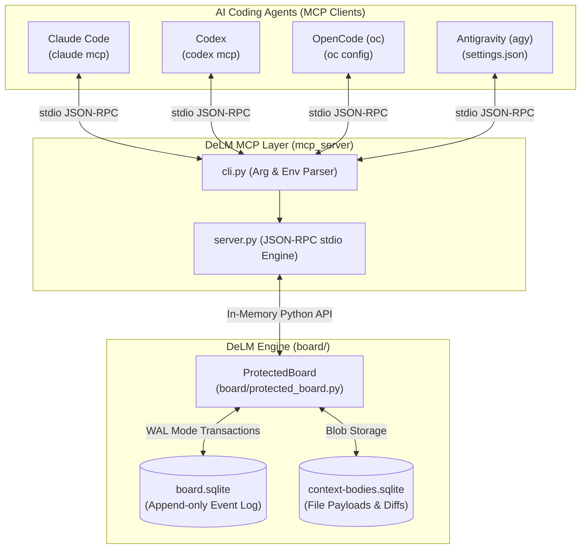
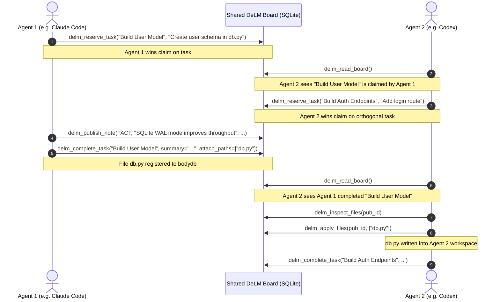

# DeLM Multi-Agent MCP Server Architecture & Technical Reference

This document details the architectural design, internal implementation mechanics, and end-to-end usage of the DeLM Model Context Protocol (MCP) server.

---

## 1. High-Level Architecture

The DeLM MCP server bridges the gap between AI coding assistants (Claude Code, OpenAI Codex, OpenCode, and Antigravity) and DeLM's decentralized multi-agent coordination engine.

Instead of relying on a centralized coordinator model that orchestrates subagents, DeLM enables **peer-to-peer asynchronous coordination**:
- Agents discover tasks and claim work without an orchestrator bottleneck.
- Agents publish verified discoveries (`FACT`) and disproven hypotheses/blockers (`FAIL`).
- Agents inspect and apply diffs from other agents' work workspaces.



---

## 2. Core Implementation Mechanics

The server is implemented in [`mcp_server/server.py`](../mcp_server/server.py) with zero third-party dependencies, running strictly on the Python standard library (3.10+). File safety lives in [`mcp_server/files.py`](../mcp_server/files.py), which ports the Docker harness client's (`board/context_client.py`) attach/apply rules to MCP mode.

### A. Transport & Protocol Framing
The MCP specification communicates over standard input/output (`stdio`).
- **Framing**: Supports both HTTP-style header-framed messages (`Content-Length: <n>\r\n\r\n{...}`) and raw newline-delimited JSON, including batch arrays.
- **Protocol Handshake**: Implements standard JSON-RPC 2.0 methods:
  - `initialize`: Negotiates the protocol version (supports `2024-11-05`, `2025-03-26`, `2025-06-18`; echoes the client's version when supported, otherwise the newest).
  - `tools/list`: Exposes available coordination tools with complete JSON schema specifications.
  - `tools/call`: Dispatches function calls with validation and error formatting.
  - `resources/list`, `prompts/list`: Return empty lists (the board exposes neither).
  - `ping`: Health-check keepalive.
  - Unknown notifications (no `id`) are ignored; unknown requests return `-32601` and unknown tools return `-32602`.

### B. Shared Context & Dual-Database Storage
The server wraps [`ProtectedBoard`](../board/protected_board.py) (the same hardened board the Docker harness uses), which uses a dual-database pattern:
1. `board.sqlite`:
   - Append-only event log (`events` table) storing sequence numbers, nanosecond timestamps, actor names, event kinds (`item`, `claim`, `done`, `note`, `status`, `read`, `wait`), and lightweight payloads.
   - Used for synchronization and atomic queue transitions.
2. `context-bodies.sqlite`:
   - Attached via SQLite's `ATTACH DATABASE ... AS bodydb`.
   - Stores file payloads, diff fingerprints, and publication metadata (`bodies`, `publications` tables).
   - Keeps large file contents out of the main transaction log so reads and status polls remain microsecond-fast.

### C. Concurrency & Collision Safety
- **Normalized Deduplication**: Task reservations normalize text (ignoring case and whitespace), preventing two agents from claiming duplicate variants of the same task.
- **Single-Claim Invariant**: An agent holding an unfinished item is blocked from claiming a second one until the active item is completed.
- **Conflict-Safe Apply**: `delm_apply_files` goes through `ProtectedBoard.apply` with the caller's real local hashes: files the caller edited (or that another author changed) are reported as `conflict` and **nothing is written**. Granted files are staged to temp files and renamed over the targets with rollback, so a failed apply never leaves a half-written workspace. Every decision is logged as an `apply` event; successes and failures are confirmed via `apply_result`/`apply_error`.
- **Path Confinement**: Attach/apply paths must stay inside the agent workspace (or under `/tmp`); `..` segments, symlinks, and credential/cache directories (`.env`, keys, `.git`, `node_modules`, …) are rejected before anything reaches the board.
- **Idempotent Publications**: `delm_complete_task`/`delm_publish_note` accept `request_id`; retries with the same key return the original publication instead of duplicating it (a deterministic key is derived when the client omits one).

---

## 3. Tool Reference

The MCP server exposes 10 coordination tools to connected models. Board text renders
full item and publication ids: they are the handles agents pass back to
`delm_claim_task`, `delm_inspect_files`, `delm_apply_files`, and `delm_verify_task`.

| Tool | Action | Primary Arguments | Description |
| :--- | :--- | :--- | :--- |
| `delm_read_board` | Read / Poll | `wait_seconds`, `full`, `target` | Reads current queue state, peer notes, and statuses. With `wait_seconds > 0`, blocks until a wake event occurs. |
| `delm_reserve_task` | Atomic Scope Claim | `subject`, `detail` | Creates a new task item and claims it atomically. If an equivalent subject already exists, returns existing status. |
| `delm_publish_items` | Publish Open Work | `items` | Publishes open queue items for any peer to claim, without taking ownership. |
| `delm_claim_task` | Claim Open Task | `item_id` | Claims an already published open task from the queue. |
| `delm_complete_task` | Complete Work | `item_id`, `summary`, `attach_paths`, `request_id` | Marks item done, registers completion summary, and attaches workspace files into `context-bodies.sqlite`. |
| `delm_publish_note` | Share Knowledge | `note_type` (`FACT`/`FAIL`), `text`, `scope`, `basis`, `attach_paths`, `request_id` | Broadcasts discoveries or blockers with reproducible evidence. |
| `delm_verify_task` | Peer Verification | `item_id`, `verdict`, `evidence` | Records an independent accept/reject check of a completed item; advisory only, author excluded. |
| `delm_update_status` | Status Broadcast | `text` | Informs peers of current focus (e.g. `"Investigating memory leak in auth.py"`). |
| `delm_inspect_files` | Diff Preview | `publication_id`, `paths` | Displays unified diffs against the baseline (`--baseline`, else the agent workspace) or full text for new files. |
| `delm_apply_files` | Merge Files | `publication_id`, `paths`, `on_conflict` | Conflict-checked merge of a peer publication into the local workspace; refused on local edits unless `on_conflict: "markers"` writes git-style conflict blocks. |

---

## 4. Multi-Agent Workflow Example

Here is how two autonomous agents collaborate on a codebase using the MCP tools:



---

## 5. How It Is Used Across Clients

Each client launches an MCP server process over standard I/O pointing to the same shared SQLite file (`.delm/board.sqlite`).

Install once with `pipx install /path/to/DeLM` (or run uninstalled via `python3 /path/to/DeLM/mcp_server/cli.py`; no `PYTHONPATH` needed), or run the containerized server (`docker build -f mcp_server/Dockerfile -t delm-mcp:1.0.0 .`). Full per-client JSON, including a `docker run -i` client configuration, is in the [setup guide](MCP_SETUP_GUIDE.md).

### Claude Code
```bash
claude mcp add delm -- delm-mcp \
  --actor claude-agent \
  --board /shared/project/.delm/board.sqlite \
  --workspace /shared/project/work-claude
```

### OpenAI Codex (`~/.codex/config.json`)
`"command": "delm-mcp"`, args: `--actor codex-agent --board /shared/project/.delm/board.sqlite --workspace /shared/project/work-codex`.

### OpenCode (`~/.config/opencode/mcp.json`)
`"command": "delm-mcp"`, args: `--actor oc-agent --board /shared/project/.delm/board.sqlite --workspace /shared/project/work-oc`.

### Antigravity (`~/.gemini/settings.json`)
`"command": "delm-mcp"`, args: `--actor agy-agent --board /shared/project/.delm/board.sqlite --workspace /shared/project/work-agy`.

---

## 6. Verification and Diagnostics

1. **Automated Unit & Multi-Agent Tests** (60+ tests: protocol, validation, publish/claim, diffs, conflict-safe apply, markers merge, path safety, verification, idempotency, CLI wiring, worktree isolation, lessons harvest):
   ```bash
   python3 -m unittest tests/test_mcp_server.py -v
   ```
2. **Direct CLI Diagnostic**:
   ```bash
   echo '{"jsonrpc": "2.0", "id": 1, "method": "tools/list", "params": {}}' | \
     delm-mcp --actor diag --board /tmp/diag.sqlite --workspace /tmp
   ```
